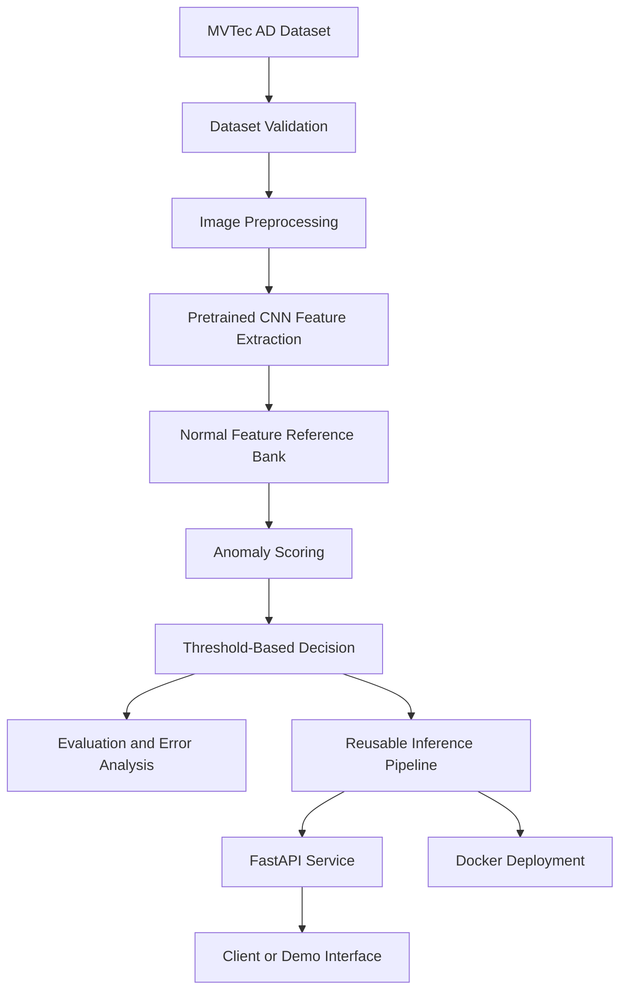

# VisionGuard
### Industrial Visual Anomaly Detection

**VisionGuard** is a computer vision and machine learning project for identifying anomalous products in industrial inspection images using a normal-only training approach. It explores how pretrained visual representations and anomaly-scoring methods can help identify products that deviate from defect-free examples.

The project focuses on more than model experimentation: it aims to connect data validation, model development, evaluation, reusable inference, API integration, testing, and containerization into a reproducible ML engineering workflow.

**Project type:** Machine Learning · Deep Learning · Computer Vision · MLOps

**Repository:** [AdityaChhimwal/visionguard](https://github.com/AdityaChhimwal/visionguard)

---

## Table of Contents

- [Problem Statement](#problem-statement)
- [Project Objectives](#project-objectives)
- [How It Works](#how-it-works)
- [Dataset](#dataset)
- [Technology Stack](#technology-stack)
- [Project Architecture](#project-architecture)
- [Getting Started](#getting-started)
- [Dataset Setup](#dataset-setup)
- [Training and Inference](#training-and-inference)
- [API](#api)
- [Evaluation](#evaluation)
- [Docker](#docker)
- [Testing](#testing)
- [Engineering Practices](#engineering-practices)
- [Limitations](#limitations)
- [Future Improvements](#future-improvements)
- [License and Dataset Usage](#license-and-dataset-usage)

## Problem Statement

Industrial quality inspection requires identifying defects such as surface damage, contamination, structural irregularities, and other deviations from expected product appearance.

Supervised classification often requires labeled examples of the defect classes the model is expected to recognize. In real inspection settings, defective samples may be scarce, and previously unseen defects may occur.

Visual anomaly detection offers an alternative: learn a representation of normal products and identify observations that differ from the learned normal patterns.

VisionGuard explores this approach using the MVTec Anomaly Detection (MVTec AD) benchmark.

## Project Objectives

The project aims to:

- Build a reproducible visual anomaly-detection pipeline.
- Validate dataset structure and image integrity before model execution.
- Extract visual features using a pretrained convolutional neural network.
- Establish a baseline anomaly detector using normal training images.
- Produce image-level anomaly scores and normal/anomalous decisions.
- Evaluate performance using appropriate metrics and error analysis.
- Separate training, model artifacts, and inference logic.
- Expose inference through a lightweight HTTP API.
- Add automated tests and containerized execution.
- Document design decisions, limitations, and reproducibility requirements.

## How It Works

The intended workflow is:



### 1. Dataset validation

Validate the expected directory structure, supported image formats, and image readability before processing.

### 2. Image preprocessing

Convert images to a consistent color representation and input size. Apply the preprocessing required by the selected pretrained feature extractor.

### 3. Feature extraction

Use a pretrained convolutional neural network to represent the visual characteristics of product images.

### 4. Normal reference modeling

Construct a reference representation from defect-free training images. The baseline approach explores feature-distance-based anomaly scoring.

### 5. Anomaly scoring

Compare a query image's representation with the normal reference data. Larger distances can indicate greater deviation from the learned normal appearance.

An anomaly score is a model-dependent numerical value, not automatically a probability of a defect.

### 6. Decision and evaluation

Apply a threshold selected using a documented procedure that avoids tuning on the final test labels. Evaluate predictions against the benchmark's test annotations.

### 7. Inference service

Package the reusable inference pipeline behind an API so that clients can submit images without running notebook code or retraining the model for each request.

*The architecture above describes the intended system design. Only components present and verified in the repository should be considered implemented.*

## Dataset

VisionGuard uses the **MVTec Anomaly Detection (MVTec AD)** dataset, a benchmark for industrial anomaly detection.

- Official dataset page: https://www.mvtec.com/company/research/datasets/mvtec-ad
- The benchmark includes defect-free training images, normal and anomalous test images, and ground-truth annotations for applicable defects.
- Categories represent different industrial objects and textures.

The dataset is intended to evaluate whether a detector can identify deviations from normal visual appearance.

### Expected dataset structure

```text
mvtec_anomaly_detection/
├── bottle/
│   ├── train/
│   │   └── good/
│   ├── test/
│   │   ├── good/
│   │   └── <defect_type>/
│   └── ground_truth/
│       └── <defect_type>/
├── cable/
├── capsule/
├── carpet/
└── ...
```

The exact directory contents vary by category.

**Important:** Training and evaluation must respect the benchmark split. Test images and ground-truth defect masks must not be used to fit the model or select its decision threshold.

## Technology Stack

| Technology | Purpose |
|---|---|
| Python | Core implementation |
| TensorFlow / Keras | Deep learning and pretrained feature extraction |
| NumPy | Numerical computation |
| Pillow | Image loading and validation |
| Pandas | Evaluation result analysis |
| scikit-learn | Evaluation metrics and supporting utilities |
| FastAPI | HTTP inference interface |
| pytest | Automated testing |
| Docker | Reproducible application packaging |
| Git and GitHub | Version control and source hosting |

The exact dependencies and versions are defined by the repository's dependency configuration.

## Project Architecture

The implementation separates experimentation from reusable application code.

| Component | Responsibility |
|---|---|
| Data validation | Check dataset paths, structure, and image integrity |
| Feature extraction | Apply consistent preprocessing and obtain visual representations |
| Anomaly detector | Compare query features with normal reference features |
| Training pipeline | Build the detector and persist inference artifacts |
| Inference pipeline | Load saved artifacts and score new images |
| Evaluation | Calculate metrics and investigate model errors |
| API | Validate requests and return inference results |
| Tests | Verify core behavior and failure handling |
| Docker | Package the application for repeatable execution |

See the repository for the authoritative directory structure and implementation details.

## Getting Started

### Prerequisites

- Python version compatible with the project's pinned dependencies.
- Git.
- The MVTec AD dataset, downloaded separately under its applicable terms.
- Docker, if containerized execution is required.

### 1. Clone the repository

```bash
git clone https://github.com/AdityaChhimwal/visionguard.git
cd visionguard
```

### 2. Create a virtual environment

On Windows PowerShell:

```powershell
py -m venv .venv
.\.venv\Scripts\Activate.ps1
```

On macOS or Linux:

```bash
python3 -m venv .venv
source .venv/bin/activate
```

### 3. Install dependencies

```bash
python -m pip install --upgrade pip
pip install -r requirements.txt
```

Use the Python version specified by the project configuration if it differs from your local default.

## Dataset Setup

Download MVTec AD from its official source and extract it outside the tracked source-code directories.

For Windows PowerShell:

```powershell
$env:VISIONGUARD_DATASET_ROOT = "D:\good_projects\visionguard\mvtec_anomaly_detection"
```

For macOS or Linux:

```bash
export VISIONGUARD_DATASET_ROOT="/path/to/mvtec_anomaly_detection"
```

The application should read the dataset location from configuration or an environment variable rather than relying on a machine-specific absolute path.

Run the dataset validation command documented by the current implementation before training. Confirm that the configured path contains the expected category, training, test, and annotation directories.

Dataset files and large generated artifacts should not be committed to the Git repository.

## Training and Inference

The training pipeline should use the normal training split to construct the anomaly detector and save the artifacts required for inference.

The intended workflow is:

1. Validate the configured dataset.
2. Load the selected category's defect-free training images.
3. Apply the configured preprocessing.
4. Extract visual features.
5. Construct the normal reference representation.
6. Select the decision threshold using the documented normal-only calibration procedure.
7. Save the model artifacts and configuration.
8. Load the saved artifacts in the inference pipeline.
9. Score new images and return the corresponding prediction.

Use the actual training and inference commands defined by the repository. The precise module paths and CLI arguments must match the implemented code; no training command or artifact is assumed to exist solely because it is described here.

## API

The intended service provides an HTTP interface for image-level inference.

| Endpoint | Purpose |
|---|---|
| `GET /health` | Report service health |
| `POST /predict` | Accept an image and return an anomaly prediction |

A prediction response should expose the fields supported by the implementation, such as:

- Predicted class: normal or anomaly.
- Anomaly score.
- Decision threshold.
- Model or category metadata, where available.

Example response schema:

```json
{
  "prediction": "anomaly",
  "anomaly_score": 0.0,
  "threshold": 0.0,
  "model_version": "example"
}
```

The values above are illustrative placeholders, not measured predictions or actual model output.

The service should validate uploaded image content, handle malformed requests appropriately, and load the trained inference artifacts rather than fitting a model on each request.

Once the API module is implemented, follow its documented startup command. FastAPI applications commonly expose interactive API documentation at `/docs`, but the actual URL depends on the configured host, port, and application entry point.

## Evaluation

Evaluation should distinguish between image-level anomaly detection and pixel-level defect localization.

### Image-level evaluation

Appropriate metrics include:

- **AUROC:** Measures how well anomaly scores rank anomalous images above normal images across thresholds.
- **Average precision:** Summarizes precision-recall performance.
- **Precision:** Measures the proportion of predicted anomalies that are truly anomalous.
- **Recall:** Measures the proportion of anomalous samples successfully detected.
- **F1 score:** Combines precision and recall at a chosen threshold.
- **Confusion matrix:** Shows the counts of correct and incorrect binary predictions.

### Localization evaluation

Pixel-level metrics and localization visualizations are appropriate only if the implemented detector generates spatial anomaly maps and the evaluation correctly compares them with the ground-truth masks.

### Evaluation principles

- Preserve the benchmark's train/test separation.
- Do not use final test labels to tune the model or threshold.
- Report the category, evaluation split, and methodology alongside metrics.
- Investigate false positives and false negatives.
- Distinguish smoke-test results from full evaluation results.
- Publish only metrics produced by an actual, reproducible run.

No benchmark score is claimed in this README. Actual results should be added after the implemented evaluation pipeline has been executed and verified.

## Docker

Docker is intended to package the inference service with its application dependencies.

After verifying that the Dockerfile and artifact-loading workflow are functional, the standard workflow is:

```bash
docker build -t visionguard .
```

Run the container using the actual application port and artifact configuration:

```bash
docker run --rm -p 8000:8000 visionguard
```

The example assumes that the application listens on port `8000`. Adjust the command if the implemented service uses a different port or requires a mounted artifact directory or additional environment variables.

The dataset and large model artifacts should not be copied into the image unnecessarily. Follow the project's documented artifact-mounting or artifact-loading strategy.

A successful image build alone does not prove that the model loads or that inference works. Verify the health endpoint and submit a valid image to test the complete containerized workflow.

## Testing

Run the repository's documented test suite. If pytest is configured, the standard command is:

```bash
python -m pytest -v
```

Useful test coverage includes:

- Dataset structure validation.
- Image decoding and preprocessing.
- Anomaly score calculations.
- Threshold decision boundaries.
- Artifact serialization and loading.
- Valid and invalid inference requests.
- API response schemas and error handling.

Tests should be runnable without downloading the complete MVTec AD dataset wherever possible, using synthetic inputs and temporary directories for isolated unit tests.

Test results should be recorded only after execution.

## Engineering Practices

VisionGuard emphasizes the practices needed to move from an ML experiment to a reproducible software system:

- Separation of training and inference.
- Consistent preprocessing.
- Configurable dataset and artifact paths.
- Reusable Python modules.
- Explicit model artifacts and metadata.
- Evaluation without test-data leakage.
- Input validation and error handling.
- Automated testing.
- Containerization.
- Version control and documented engineering decisions.

## Limitations

- Feature-distance-based anomaly detection depends on the quality of the pretrained representation and the normal reference data.
- A high anomaly score indicates visual deviation under the selected scoring method; it does not identify the cause of a defect by itself.
- Thresholds depend on the calibration procedure and the intended operating conditions.
- Performance can vary across object categories, defect types, image conditions, and data distributions.
- Image-level anomaly detection does not inherently provide pixel-level localization.
- Results on MVTec AD do not guarantee performance on images from a different factory, camera, product line, or manufacturing process.
- A research benchmark does not establish industrial reliability, safety, or production readiness.

VisionGuard is an educational and research-oriented portfolio prototype. It is not a certified industrial inspection system and should not be used as the sole basis for manufacturing quality or safety decisions.

## Future Improvements

Potential extensions, depending on measured baseline performance and available time, include:

- Spatial anomaly maps and pixel-level localization.
- Patch-based anomaly detection methods.
- Evaluation across additional MVTec AD categories.
- More comprehensive false-positive and false-negative analysis.
- Improved inference efficiency and artifact management.
- Continuous integration for automated tests.
- A simple image-upload interface.
- Deployment to a suitable hosting platform after resource and cost assessment.

These are potential extensions, not claims that every feature is currently implemented.

## License and Dataset Usage

The source code and the MVTec AD dataset are separate materials with potentially different licensing terms.

Review the repository's own `LICENSE` file, if present, for the code's licensing terms. Review the official MVTec AD terms before downloading, redistributing, or using the dataset, particularly for commercial purposes.

Do not assume that permission to use the source code grants permission to redistribute the dataset or its annotations.

---

**VisionGuard — From visual anomaly detection experiments to a reproducible ML engineering system.**
