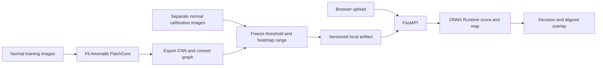
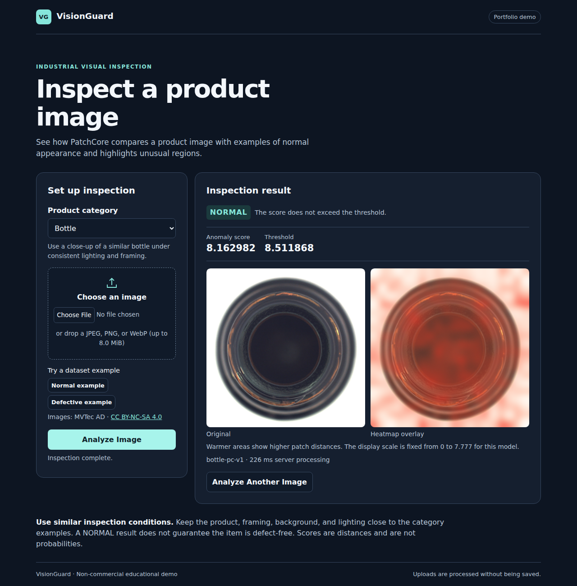

# VisionGuard — Industrial Visual Anomaly Detection

VisionGuard is a non-commercial portfolio demo for checking product images under repeatable inspection conditions. Upload a product image and the service returns a PatchCore decision, its raw anomaly score and threshold, and an aligned heatmap overlay. The first release targets **MVTec AD Bottle**. Each category needs its own fitted, verified artifact.

**Deployment:** No public inference URL is verified yet. [Deploy on Render Free](https://render.com/deploy?repo=https%3A%2F%2Fgithub.com%2FAdityaChhimwal%2Fvisionguard) or run the real model locally.



PatchCore uses an ImageNet-pretrained CNN to represent small regions at two feature scales. During preparation it keeps a representative subset of patches from **normal** bottles. During inspection it finds the nearest stored patch for each new patch. The largest distance becomes the image score; the distances across the frame form the anomaly map. A score is a distance, and NORMAL means it did not exceed the chosen threshold.

FastAPI serves the page and API from one origin. Plain HTML, CSS and JavaScript handle upload and comparison. Anomalib and PyTorch prepare the model; ONNX Runtime executes the checked, exported graph in the service. There is one application process and no database or image storage.

## Real inspection results



See the [mobile defect result](docs/screenshots/mobile.png). Screenshots come from the [real Chromium check](https://github.com/AdityaChhimwal/visionguard/actions/runs/42185022406); Bottle imagery is attributed in [NOTICE](NOTICE.md).

On 83 MVTec AD Bottle test images, image AUROC was **0.9984**, pixel AUROC **0.9718**, and F1 **0.9692** at a cutoff of **8.511868**. Four of 20 good images were flagged; all 63 defective images were detected. The Linux runner measured **220 ms** median warm loopback latency and **188 MiB** peak sampled process RSS. See the [full report](docs/verification.md) for protocol and limits.

## Run with a prepared artifact

Use 64-bit Python 3.13 and [uv](https://docs.astral.sh/uv/getting-started/installation/). Run commands from the repository root on Windows PowerShell or Linux.

```text
uv sync --locked --python 3.13 --no-dev
uv run --no-sync uvicorn visionguard.api.main:app --host 127.0.0.1 --port 8000 --no-access-log
```

First place the prepared `bottle-pc-v1/` directory under `artifacts/`. It must contain `patchcore.onnx`, `metadata.json`, and `split.json` together. Use your own preparation below or the reviewed bundle linked in [deployment](docs/deployment.md). Open [localhost:8000](http://localhost:8000), or check `/ready`. Restart the process after installing or changing an artifact. Optional example PNGs go in `artifacts/samples/bottle/`.

## Prepare and evaluate from scratch

Read the [MVTec AD dataset terms](https://www.mvtec.com/research-teaching/datasets/mvtec-ad) and [attribution](NOTICE.md) before downloading. Use the publisher's Bottle archive if available. The helper downloads a pinned mirror of the Bottle images and masks, plus the exact pretrained weight file into ignored `data/`. The directory structure is `data/mvtec/bottle/{train,test,ground_truth}`.

```text
uv sync --locked --python 3.13 --group prepare --group browser
uv run --no-sync python -m scripts.fetch_bottle
uv run --no-sync python -m scripts.dataset --dataset data/mvtec/bottle
uv run --no-sync python -m scripts.prepare --config configs/bottle.toml --dataset data/mvtec/bottle --weights data/resnet18.a1_in1k.safetensors --output artifacts/bottle-pc-v1
uv run --no-sync python -m scripts.evaluate --dataset data/mvtec/bottle --artifact artifacts/bottle-pc-v1 --category bottle --version bottle-pc-v1 --output outputs/bottle-evaluation.json
uv run --no-sync python -m scripts.stage_examples --dataset data/mvtec/bottle
```

Preparation refuses to overwrite an artifact. For experiments, use a new version and directory. The release split is 167 fitting normals and 42 calibration normals (seed 42), with a separate 83-image test set. The frozen cutoff is the empirical 95th percentile with the higher order statistic, using only calibration normals. This small calibration set cannot guarantee a future false-positive rate. The [verification report](docs/verification.md) records measured results and scope.

## API

| Endpoint | Purpose |
| --- | --- |
| `GET /health` | Process health |
| `GET /ready` | Returns 503 until a configured artifact loads and runs |
| `GET /api/categories` | Warmed categories, examples, and upload limits |
| `POST /api/predict?category=bottle` | Accepts raw JPEG, PNG or WebP bytes |
| `GET /docs` | Interactive API reference |

```sh
curl -fsS -H "Content-Type: application/octet-stream" --data-binary "@data/mvtec/bottle/test/good/000.png" "http://127.0.0.1:8000/api/predict?category=bottle"
```

On Windows use `curl.exe`. The response has `category`, `label`, `anomaly_score`, `threshold`, `model_version`, `processing_ms`, `heatmap_range`, and two PNG data URLs (`original` and `overlay`). The server compares the raw score using strict `>`; the separately calibrated display range applies to all images for that artifact. Errors return `{"code":"…","message":"…"}`. Oversized uploads return 413; bad images 422; a busy process 429; missing models 503.

## Project map and checks

| Folder | Contents |
| --- | --- |
| `visionguard/api` | HTTP routes, upload limits, startup model registry |
| `visionguard/ml` | Image transforms, PatchCore adapter, artifact loading and overlays |
| `visionguard/web` | Single inspection page |
| `scripts` | Dataset, preparation, evaluation, sample, runtime and browser commands |
| `configs`, `tests`, `docs` | Release settings, tests, handover |

```text
uv sync --locked --python 3.13
uv run --no-sync ruff check .
uv run --no-sync python -m pytest -m "not ml" -q
```

For the actual Anomalib adapter check, install the `prepare` group and run `uv run --no-sync python -m pytest -m ml -q`. For real browser checks, provision Bottle and stage examples first, then run `uv run --no-sync playwright install chromium` and `uv run --no-sync python -m scripts.verify_browser --dataset data/mvtec/bottle`. See [container and hosting](docs/deployment.md) and the [interview guide](docs/interview-guide.md).

## Troubleshooting and limits

- **No category:** Check `/ready` and startup logs for a missing, incompatible, or modified artifact. Run from the repository root or set `VG_CONFIG` and `VG_ARTIFACTS` to absolute paths.
- **Upload rejected:** Use a still JPEG, PNG, or WebP within the advertised byte limit and 12 million decoded pixels by default.
- **Poor result:** Use a similarly framed Bottle image with a consistent background and lighting. Small defects may blur at 160 × 160; unfamiliar products or backgrounds may dominate the score.
- **Next steps:** Validate under different cameras and lighting before adding categories. With more independent normal samples, estimate operating uncertainty and select a threshold for the target inspection cost.

Credit: [PatchCore paper](https://arxiv.org/abs/2106.08265), [original implementation](https://github.com/amazon-science/patchcore-inspection), [Anomalib](https://anomalib.readthedocs.io/), and [MVTec AD](https://www.mvtec.com/research-teaching/datasets/mvtec-ad). VisionGuard integrates those tools; it is an application engineering project.
