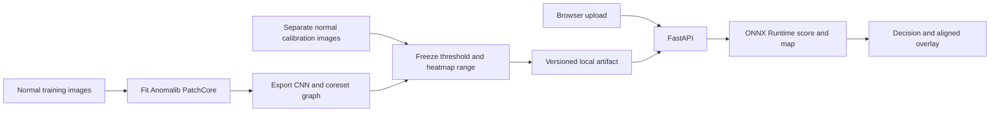
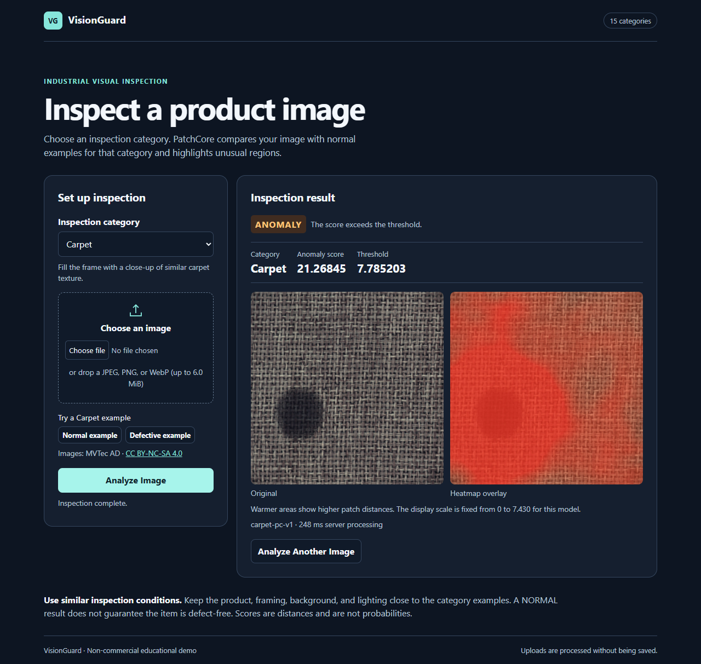

# VisionGuard — Industrial Visual Anomaly Detection

VisionGuard is a non-commercial portfolio app for inspecting products and surfaces under repeatable imaging conditions. Select one of the **15 MVTec AD categories**, upload an image, and get a PatchCore decision, an anomaly score and threshold, and an aligned heatmap. Each category has a separately fitted and calibrated model and two real examples.

The hosted app can take a short while to wake after inactivity. [Open VisionGuard on Render](https://visionguard-ljwy.onrender.com) · [Check the hosted categories](https://visionguard-ljwy.onrender.com/ready)

| Objects | Textures |
| --- | --- |
| Bottle, Cable, Capsule, Hazelnut, Metal nut, Pill, Screw, Toothbrush, Transistor, Zipper | Carpet, Grid, Leather, Tile, Wood |



PatchCore uses an ImageNet-pretrained CNN to represent small regions at two feature scales. During preparation it keeps a representative subset of patches from normal training images for each category. During inspection it finds the nearest stored patch for each new patch. The largest distance becomes the image score. Distances across the frame form the anomaly map. NORMAL means the score stayed within the selected model's threshold.

FastAPI serves the page and API from one process. Plain HTML, CSS and JavaScript handle upload and comparison. Anomalib and PyTorch prepare the models offline. ONNX Runtime executes the exported graphs. A bounded cache keeps one session resident on Render, and the browser requests compact JPEG previews.

## Real inspection results



The desktop and mobile checks exercise category switching, real image uploads, heatmaps, and invalid inputs. [Mobile screenshot](docs/screenshots/mvtec-mobile.png) · [Release verification](https://github.com/AdityaChhimwal/visionguard/actions/runs/42273202241) · [Image attribution](NOTICE.md)

Across **1,725 held-out images** in all 15 categories, macro image AUROC was **0.9344**, macro pixel AUROC was **0.9535** (binned), and macro F1 was **0.8819**. At the frozen thresholds the models missed 205 defects and flagged 69 normal images. Every category's results are reported separately. [Benchmark report](docs/mvtec-ad-results.md)

## Run with a prepared artifact

Use 64-bit Python 3.13 and uv. These commands run from the repository root in Git Bash or Linux. [Install uv](https://docs.astral.sh/uv/getting-started/installation/)

```bash
uv sync --locked --python 3.13 --no-dev
BASE=https://github.com/AdityaChhimwal/visionguard/releases/download/mvtec-ad-pc-v1
SHA=$(curl -fsSL "$BASE/mvtec-ad-pc-v1.sha256" | tr -d '\r\n')
uv run --no-sync python -m scripts.provision_bundle --url "$BASE/mvtec-ad-pc-v1.tar.xz" --sha256 "$SHA"
VG_REQUIRE_ALL_MODELS=1 uv run --no-sync uvicorn visionguard.api.main:app --host 127.0.0.1 --port 8000
```

The full archive needs a fresh `artifacts/` directory. If upgrading a Bottle installation, stop the app and move its current `artifacts/` directory into the ignored `outputs/` directory first. Open the local app, choose an object or texture, and try both examples. [Local app](http://localhost:8000) · [Prepared release](https://github.com/AdityaChhimwal/visionguard/releases/tag/mvtec-ad-pc-v1)

## Prepare and evaluate from scratch

The fetcher checks the complete category inventory and each downloaded PNG against the pinned mirror, then checks the encoder weights. Preparation saves the split, threshold, exported graph and provenance. The evaluation uses the entire official test split. [Dataset terms](https://www.mvtec.com/research-teaching/datasets/mvtec-ad) · [Attribution](NOTICE.md)

```bash
uv sync --locked --python 3.13 --group prepare
uv run --no-sync python -m scripts.fetch_mvtec --category toothbrush
uv run --no-sync python -m scripts.build_mvtec --category toothbrush --artifacts outputs/reproduced/artifacts --reports outputs/reproduced/reports
```

Replace `toothbrush` with another category ID, or run the training matrix to build all 15. Across the full release, 2,900 normal images fit the memory banks and a disjoint 729 normal images set the thresholds. The seed controls the split and the coreset sampling. [Training workflow](.github/workflows/mvtec-models.yml)

## API

| Endpoint | Purpose |
| --- | --- |
| `GET /health` | Process health |
| `GET /ready` | Verified model IDs, or 503 if required models are missing |
| `GET /api/categories` | Available categories, examples and upload limits |
| `POST /api/predict?category=carpet&preview=jpeg` | Accepts raw JPEG, PNG or WebP bytes and returns compact previews |
| `GET /docs` | Interactive API reference |

```sh
curl -fsS -H "Content-Type: application/octet-stream" --data-binary "@artifacts/samples/carpet/defect.png" "http://127.0.0.1:8000/api/predict?category=carpet&preview=jpeg"
```

The response includes `category`, `label`, `anomaly_score`, `threshold`, `model_version`, `processing_ms`, `heatmap_range`, and two image data URLs in `original` and `overlay`. The API defaults to PNG. JPEG previews retain the same score and threshold. Errors include a `code` and `message`. Oversized uploads return 413, invalid images 422, busy inference 429, and missing models 503.

## Project map and checks

| Folder | Contents |
| --- | --- |
| `visionguard/api` | HTTP routes, upload limits, startup model registry |
| `visionguard/ml` | Image transforms, PatchCore adapter, artifact loading and overlays |
| `visionguard/web` | Single inspection page |
| `scripts` | Dataset, preparation, evaluation, sample, runtime and browser commands |
| `configs`, `tests`, `docs` | Release settings, tests, handover |

```text
uv sync --locked --python 3.13
uv run --no-sync ruff check .
uv run --no-sync python -m pytest -m "not ml" -q
```

For the Anomalib integration test, install the `prepare` group and run `uv run --no-sync python -m pytest -m ml -q`. With the full bundle running, check all 30 real examples using `python -m scripts.verify_public --url http://127.0.0.1:8000 --all-categories`. [Container and hosting](docs/deployment.md) · [Interview guide](docs/interview-guide.md)

## Troubleshooting and limits

- **No category:** Check `/ready` and startup logs for a missing, incompatible, or modified artifact. Run from the repository root or set `VG_CONFIG` and `VG_ARTIFACTS` to absolute paths.
- **Upload rejected:** Use a still JPEG, PNG, or WebP within the advertised byte limit and 12 million decoded pixels by default.
- **Poor result:** Choose the category manually and match the framing and lighting of its examples. Small defects may blur at 160 × 160. Unfamiliar products and backgrounds can dominate the score.
- **Model limits:** Grid recall was 0.4035 at its frozen threshold. A real inspection line needs independent validation for its own camera, lighting and cost of missed defects.

Credit: [PatchCore paper](https://arxiv.org/abs/2106.08265), [original implementation](https://github.com/amazon-science/patchcore-inspection), [Anomalib](https://anomalib.readthedocs.io/), and [MVTec AD](https://www.mvtec.com/research-teaching/datasets/mvtec-ad). VisionGuard integrates those tools; it is an application engineering project.
